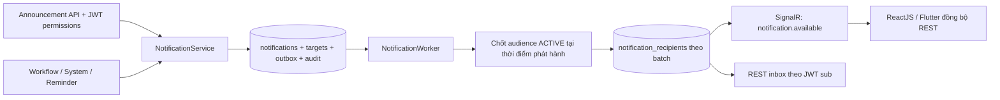

# HRM Notification Center

Triển khai dùng chung cho ReactJS và Flutter; không chạy Migration, seed, SQL hoặc cập nhật Railway. Entity Notification hiện có vẫn ở Modules/System/Entities để không tạo class trùng. Logic mới nằm trong Modules/Notifications.

## Kiến trúc



Nội dung lưu một lần trong notifications, không nhân 5.000 bản nội dung. Worker chốt audience bằng truy vấn UNION/DISTINCT trong transaction SERIALIZABLE, INSERT recipient theo batch mặc định 250, rồi chuyển PUBLISHED và hoàn tất outbox trong cùng transaction. Chưa commit thì recipient chưa được API nhìn thấy. Không gọi SignalR trong transaction phân phối hoặc trong request tạo/phát hành HTTP.

Outbox có PK notification_id, lease token, locked_until, số lần thử, backoff và trạng thái PENDING/PROCESSING/COMPLETED/CANCELLED/DEAD. Lease được claim bằng UPDATE có điều kiện; unique recipient PK chống trùng. Crash trước commit rollback toàn bộ publication; crash sau commit không tạo lại recipient. Job hoàn tất bị chạy lại cũng không tạo lại inbox.

Worker gửi realtime theo batch tối đa 100 mỗi chu kỳ, dùng lease riêng từng recipient. Retry tối đa mặc định 5 lần, backoff tăng dần; DEAD/FAILED cần được người vận hành kiểm tra, không retry vô hạn. Worker mặc định **tắt** để chưa truy cập các bảng mới trước khi operator áp dụng Migration đã duyệt.

SignalR chỉ gửi `{notificationId,eventId}`, không gửi title/content, lương, dữ liệu sức khỏe hoặc hồ sơ nhân sự. SENT nghĩa transport đã chấp nhận gửi, không phải thiết bị xác nhận nhận hoặc đọc. Offline vẫn giữ inbox trong DB. Gửi realtime có semantics ít nhất một lần: crash giữa send và ghi SENT có thể gửi lại cùng eventId; client phải deduplicate theo eventId. Không tuyên bố exactly-once trên mạng.

## Schema

| Bảng | Vai trò / ràng buộc |
| --- | --- |
| notifications | title varchar(200), content varchar(1000) giữ nguyên; source, status, created_by_user_id nullable varchar(100), timestamps UTC, business reference, recipient_count, trace_id, unique deduplication_key, request_hash |
| notification_targets | notification_id FK, target_type, criteria_json được Backend validate |
| notification_recipients | PK(notification_id,user_id), FK user_id varchar(100) → users.user_id, read_at, delivery_status/attempts/next_attempt_at/sent_at, event_id và lease |
| notification_outbox | notification_id PK/FK, lịch chạy và trạng thái/lease/retry |
| role_screen_actions | PK(role_id,screen_id,action_code), FK roles/screens; grant tường minh cho action mở rộng |

Các FK dùng Restrict, không cascade xóa dữ liệu. AppDbContext chung và ApplyConfigurationsFromAssembly được giữ. Không đổi users, employees, departments, RoleDetail hoặc AuditLog schema.

## Target và điều kiện nhận

Tất cả target được OR, DISTINCT; User.Status phải ACTIVE. Danh sách không đổi sau khi PUBLISHED dù Role/phòng ban biến động.

| Type | DTO tiêu chí | Quyền gửi |
| --- | --- | --- |
| USER | userIds đúng một phần tử | SEND_USER |
| USERS | userIds một hoặc nhiều phần tử | SEND_GROUP |
| ROLE | roleIds một hoặc nhiều ID thực tế | SEND_GROUP |
| DEPARTMENT | departmentIds; User.EmployeeId → Employee.DepartmentId, EmploymentStatus=ACTIVE | SEND_GROUP |
| ALL | không kèm tiêu chí khác; mọi User ACTIVE | SEND_ALL |
| CUSTOM | filterCode=ACTIVE_EMPLOYEES: tài khoản gắn Employee đang ACTIVE | SEND_GROUP |

Không diễn giải SQL, expression hay dynamic LINQ do client gửi. FilterCode ngoài allowlist trả 400. Không tồn tại/không đủ điều kiện thì không có recipient. Giới hạn 50 target và tổng 1.000 giá trị ID cho một request; ALL/ROLE/DEPARTMENT/CUSTOM không bị giới hạn audience 1.000. SCHEDULE cần thêm khi có scheduledAt. Nhiều target yêu cầu đủ các action tương ứng, không dùng một target USER để lách SEND_ALL.

## Phân quyền

Screen code mới: **WEB_NOTIFICATIONS**. Các grant SEND_USER/SEND_GROUP/SEND_ALL/SCHEDULE/CANCEL được đọc từ role_screen_actions vào JWT khi Login; không ánh xạ nhầm sang CanNew/CanApprove và không tự grant ADMIN. Sáu quyền cũ tiếp tục đọc RoleDetail như trước. Action lạ không được cấp ngầm.

Cần operator tạo/kiểm tra screen WEB_NOTIFICATIONS theo schema thực tế và cấp các dòng role_screen_actions cho Role được duyệt sau khi áp dụng Migration. Ví dụ một dòng có role_id của HR, screen_id của WEB_NOTIFICATIONS, action_code SEND_GROUP; chỉ cấp SEND_ALL cho Role được phép broadcast toàn hệ thống. Migration không tự thêm Screen hoặc grant quyền. Đăng nhập lại để JWT mới nhận grant.

Create/Publish dùng IAuthorizationService + ScreenPermissionRequirement cho từng action dựa trên target đã validate/lưu, không tin quyền từ request. Cancel có ScreenPermission(CANCEL). Inbox/read/count chỉ cần JWT hợp lệ và User ACTIVE; mọi truy vấn lọc UserId từ sub. Không nhận userId query/body để đọc inbox người khác. Non-recipient PATCH read trả 404, thiếu SEND_ALL trả 403 HRM_AUTH_003.

SEND_GROUP cho phép gửi đến các nhóm hợp lệ; chưa có schema Data Scope để giới hạn sender theo phòng ban. Chưa tự suy đoán SELF/DEPARTMENT/ALL cho người gửi. Chỉ cấp grant nhóm cho Role đã được duyệt phạm vi đó.

## Vòng đời và nguồn

- Announcement không có scheduledAt: DRAFT; POST publish đưa vào SCHEDULED/outbox ngay, trả 202; worker chuyển PUBLISHED khi audience được commit.
- Announcement có scheduledAt tương lai: SCHEDULED/outbox, yêu cầu quyền gửi và SCHEDULE. Nhận ISO-8601 có offset, lưu và trả UTC.
- CANCEL chỉ DRAFT/SCHEDULED; lặp lại cancel idempotent. PUBLISHED trả 409, không tự recall thông báo đã đọc/gửi.
- WORKFLOW/SYSTEM/REMINDER: application service gọi CreateInternalAsync với eventKey ổn định, source thuộc allowlist, target do Backend xác định. Không có API công khai giả mạo source.
- eventKey/Idempotency-Key được scope theo source và creator, SHA-256 lưu làm dedup key. Cùng key/cùng payload trả cùng ID; cùng key/khác payload trả 409. Retry phải giữ cùng payload (bao gồm thứ tự target/ID).
- Nếu workflow đang có transaction trên cùng AppDbContext, CreateInternalAsync tham gia transaction đó; rollback nghiệp vụ rollback cả notification, audit và outbox.

Source hiện chưa có command/controller xử lý yêu cầu/phê duyệt để nối sự kiện thật; không tự thêm nghiệp vụ phê duyệt. Các workflow tương lai gọi service này trong transaction hiện có. FCM để giai đoạn tiếp theo qua INotificationTransport; chưa thêm SDK, device token hoặc secret. Khi thêm nhiều transport cần theo dõi delivery từng channel, không dùng SENT của SignalR để suy ra FCM đã gửi.

## API và Postman

| Method | URL | Kết quả |
| --- | --- | --- |
| GET | /api/notifications?limit=30&beforeId=123 | items, nextBeforeId; limit 1–100, ID giảm dần |
| GET | /api/notifications/unread-count | count riêng của sub |
| PATCH | /api/notifications/{id}/read | 204, idempotent |
| PATCH | /api/notifications/read-all | updated, chỉ inbox của sub |
| POST | /api/notifications/announcements | 201 receipt, bắt buộc Idempotency-Key |
| POST | /api/notifications/{id}/publish | 202 receipt; kiểm tra quyền theo target đã lưu |
| POST | /api/notifications/{id}/cancel | 200 receipt; CANCEL |

Tất cả cần Authorization: Bearer token. Ví dụ tạo draft:

```json
{
  "title": "Thông báo lịch làm việc",
  "content": "Vui lòng kiểm tra lịch làm việc trong ứng dụng.",
  "targets": [{"type":"USER","userIds":["employee01"]}],
  "referenceType": "WORK_SCHEDULE",
  "referenceId": "demo-schedule"
}
```

1. Sau khi schema được duyệt/áp dụng và cấp grant, Login tài khoản người gửi; đặt Idempotency-Key mới, ví dụ một UUID.
2. POST announcement rồi POST {id}/publish. Ngay sau request chưa có 5.000 send; worker thực hiện sau.
3. Login recipient, gọi list/count; PATCH read/count kiểm tra trạng thái giảm. Login người khác không phải recipient, PATCH cùng ID phải 404.
4. Thay target bằng USERS+userIds, ROLE+roleIds, DEPARTMENT+departmentIds, ALL, CUSTOM+filterCode để kiểm tra từng loại. Trộn target trùng người và kiểm tra chỉ một item.
5. Đặt scheduledAt là thời điểm UTC tương lai, ví dụ `2027-01-01T02:00:00Z`; cần SCHEDULE, trước thời điểm đó chưa có inbox. Cancel lịch phải ngăn phân phối. API không hỗ trợ sửa/reschedule target sau tạo.
6. Người gửi thiếu SEND_ALL: 403 HRM_AUTH_003, không có notification được lưu. Thu hồi grant rồi Login lại để token mới không còn quyền; token cũ giữ snapshot đến hết hạn theo JWT V2.
7. Offline/reconnect: gọi lại API list/count, không phụ thuộc có nhận SignalR trước đó. Do ID là ID tạo notification, một lịch tạo từ trước có thể được publish muộn; không dùng giả định `id > lastSeen` là đủ đồng bộ mọi lịch. Làm mới inbox và phân trang lại khi reconnect.

Lỗi nghiệp vụ: HRM_NOTIFICATION_001 (400 dữ liệu/criteria/key), _002 (409 key khác payload), _003 (404 không tìm thấy/không thuộc inbox), _004 (409 vòng đời). Giữ JSON lỗi success/code/error/message/traceId và auth codes HRM_AUTH_001…005 hiện có.

## Realtime, CORS và cấu hình

Hub `/hubs/notifications`, JWT bắt buộc; IUserIdProvider đọc đúng sub, không nhận group/user từ client. Không có Hub method cho client tự broadcast hoặc join người khác. Token query access_token chỉ nhận trên hub (browser WebSocket/SSE), không dùng được cho REST. Chỉ dùng HTTPS/WSS; server đóng connection khi access token hết hạn.

ReactJS: cấu hình accessTokenFactory, lắng nghe notification.available, dedup eventId, fetch inbox/count khi event và onreconnected. Flutter dùng cùng REST/hub; FCM chưa triển khai. Nếu chạy nhiều replica, cần SignalR backplane hoặc managed SignalR trước khi kỳ vọng realtime xuyên replica; DB inbox vẫn bền vững.

Cấu hình mới (không sửa Railway hiện tại):

```text
Notifications__WorkerEnabled=false
Notifications__PollSeconds=5
Notifications__RecipientBatchSize=250
Notifications__DeliveryBatchSize=100
Notifications__MaxAttempts=5
Notifications__LeaseSeconds=120
Notifications__AllowedOrigins__0=https://your-reviewed-hrm-web.example
```

Chỉ bật WorkerEnabled=true sau khi Migration được duyệt/áp dụng, grant được cấu hình và deployment sẵn sàng. CORS chỉ bật cho Notification REST/hub, allowlist origin rõ ràng, không wildcard. HTTP localhost chỉ cho Development. Origin rỗng mặc định không cho web cross-origin; same-origin không bị ảnh hưởng. Giữ cấu hình JWT/SigningKey, trusted proxy và access-log hiện có. Worker dùng scoped AppDbContext riêng mỗi cycle. Giới hạn được validate lúc startup.

## Audit và log

AuditLog ghi create, enqueue/publish, cancel, group/all distribution, delivery/distribution retry/failure. Metadata gồm actor/creator, notificationId, targetTypes, recipientCount, CreatedAt UTC, traceId; không chứa content, user ID list, access token hoặc FCM token. Audit cùng transaction thay đổi trạng thái. Worker chỉ log mã lỗi chung nếu cycle thất bại, không log exception/provider SQL có khả năng chứa dữ liệu nhạy cảm. API vẫn qua access logging middleware hiện có.

## Migration cần duyệt

`20261019145341_AddNotificationCenter`, sau `20261019074710_InitialHRMDatabase`. Đã đối chiếu Railway DEV bằng SELECT: notifications trống, không có FK legacy; screens chỉ có sáu cột; bốn bảng mới chưa tồn tại. Up giữ id/title/content/created_at, bỏ user_id/is_read/index cũ và thêm metadata/bảng mới. Không cần backfill trên DEV trống; không dùng bản này cho database đã có dữ liệu Notification cần giữ. Không thao tác schema screens hoặc xóa FK không tồn tại.

Down dừng trước mọi DDL để tránh mất dữ liệu sau khi đã có nhiều recipient. Designer/Snapshot hiện khớp model; has-pending-model-changes báo không có thay đổi. Migration vẫn chưa áp dụng vào Railway.

Xem [báo cáo DEV và danh sách thay đổi chính xác](NOTIFICATION_MIGRATION_DEV_REVIEW.md), [SQL để duyệt](notification-center-migration.sql), [metadata thực tế](notification-center-dev-inspection.json) và [preflight chỉ SELECT](notification-center-preflight.sql). Chưa chạy DDL/database update. Giữ worker tắt cho đến khi được duyệt/applied và đã cấp quyền.

## File tạo/sửa

Tạo:

- Modules/Notifications/Entities/NotificationTarget.cs, NotificationRecipient.cs, NotificationOutbox.cs
- Modules/Notifications/Configurations/NotificationConfigurations.cs
- Modules/Notifications/DTOs/NotificationDtos.cs
- Modules/Notifications/Services/NotificationAudience.cs, NotificationService.cs, NotificationDispatcher.cs, NotificationWorker.cs
- Modules/Notifications/Controllers/NotificationsController.cs
- Modules/Notifications/Realtime/NotificationHub.cs
- Modules/Authorization/Entities/RoleScreenAction.cs và Configurations/RoleScreenActionConfiguration.cs
- Migrations/20261019145341_AddNotificationCenter.cs và .Designer.cs
- ../HRM.API.Tests/NotificationCenterTests.cs, NotificationMigrationTests.cs
- docs/NOTIFICATION_CENTER.md, docs/notification-center-migration.sql

Sửa:

- Modules/System/Entities/Notification.cs và Configurations/NotificationConfiguration.cs
- Modules/Authorization/Services/IPermissionService.cs, PermissionService.cs; Policies/ScreenPermission.cs
- Program.cs: worker/service DI, SignalR, JWT query chỉ hub, CORS allowlist
- Migrations/AppDbContextModelSnapshot.cs
- ../HRM.API.Tests/AuthenticationApiTests.cs: thêm các entity vào SQLite context, tắt worker test, origin test
- ../HRM.API.Tests/AuthServiceTests.cs: chọn Initial migration theo tên thay vì giả định chỉ có một migration; vẫn giữ kiểm tra schema/pending cũ
- docs/API_PERMISSION_AUTHORIZATION.md: liên kết phần action mở rộng mới

Giữ các file Controller người dùng đã chuyển về Modules trước khi bắt đầu; không sửa .gitignore do người dùng thay đổi trong lúc làm. Backup source trước sửa: /private/tmp/hrm-notifications/before.tar.gz.

## Kiểm thử

Build thành công: 0 warning/0 error. Toàn bộ test: 121 đạt, 1 lỗi seed có trước, tổng 122. Ba test Migration mới xác nhận baseline DEV, kiểu/FK/index/table scope, Snapshot/target model và Down an toàn; không kiểm thử bằng cách thực thi DDL trên Railway. SQL/metadata đã được đối chiếu read-only.

Các test Notification trước đó dùng TestServer/SQLite, bao phủ USER/USERS/ROLE/DEPARTMENT/ALL 5.000/CUSTOM, OR/distinct, eligibility, snapshot, offline, API owner/read-all, JWT quyền gửi/lịch/cancel, idempotency, worker replay/lease/retry/dead, rollback workflow, SignalR authentication/user identity và CORS.

Lỗi còn lại AuthSeederTests kỳ vọng 4 Role nhưng seeder hiện chỉ có ADMIN; không thay đổi seed trong lần sửa Migration. has-pending-model-changes không còn báo Screen drift trên Snapshot hiện tại.

Tài liệu chuẩn: [SignalR authentication/UserIdProvider](https://learn.microsoft.com/aspnet/core/signalr/authn-and-authz), [EF Core ExecuteUpdate và transaction](https://learn.microsoft.com/en-us/ef/core/saving/execute-insert-update-delete).
